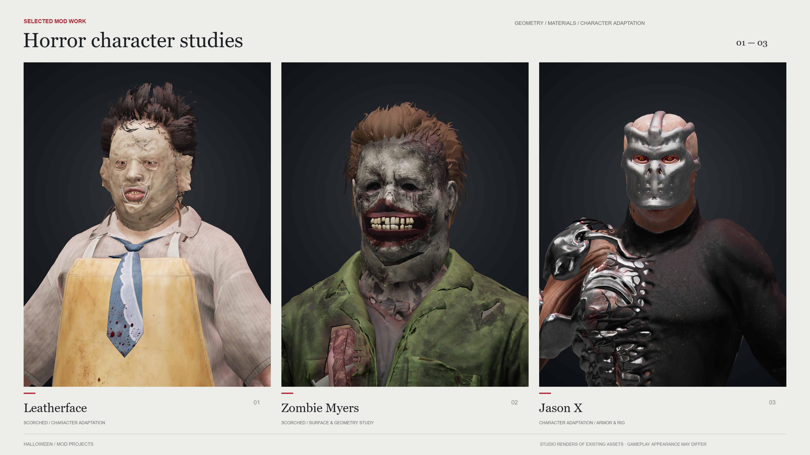

# chud

Beginner creator focused on horror character mods.  
Exploring **Blender**, **Python** & **Unreal asset tooling**.

[Mods on Nexus](https://next.nexusmods.com/profile/chudlet) · [TikTok — gameplay & mods](https://www.tiktok.com/@chudsun) · [Renders & project notes](SHOWCASE.md)

### Selected work

**Leatherface · Zombie Myers · Jason X**  
Character adaptations for Halloween, with a bonus Bloodied Bandages study in the gallery.

[View the gallery](SHOWCASE.md) · [Watch the studio loop](showcase-reel.mp4)

### Currently learning

Mesh fitting, skin weights, materials, and Python-assisted asset workflows.

Learning as I go—feedback is welcome.

Character adaptations using existing assets, made with AI assistance. See the gallery for credits and render details.
