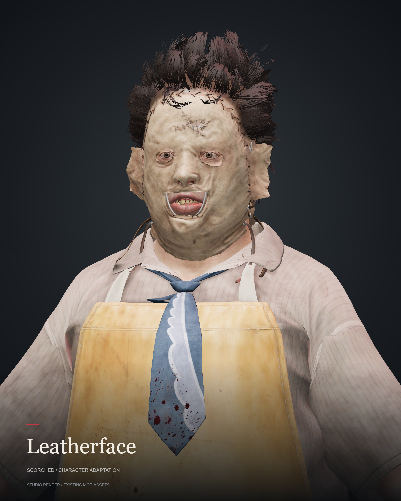
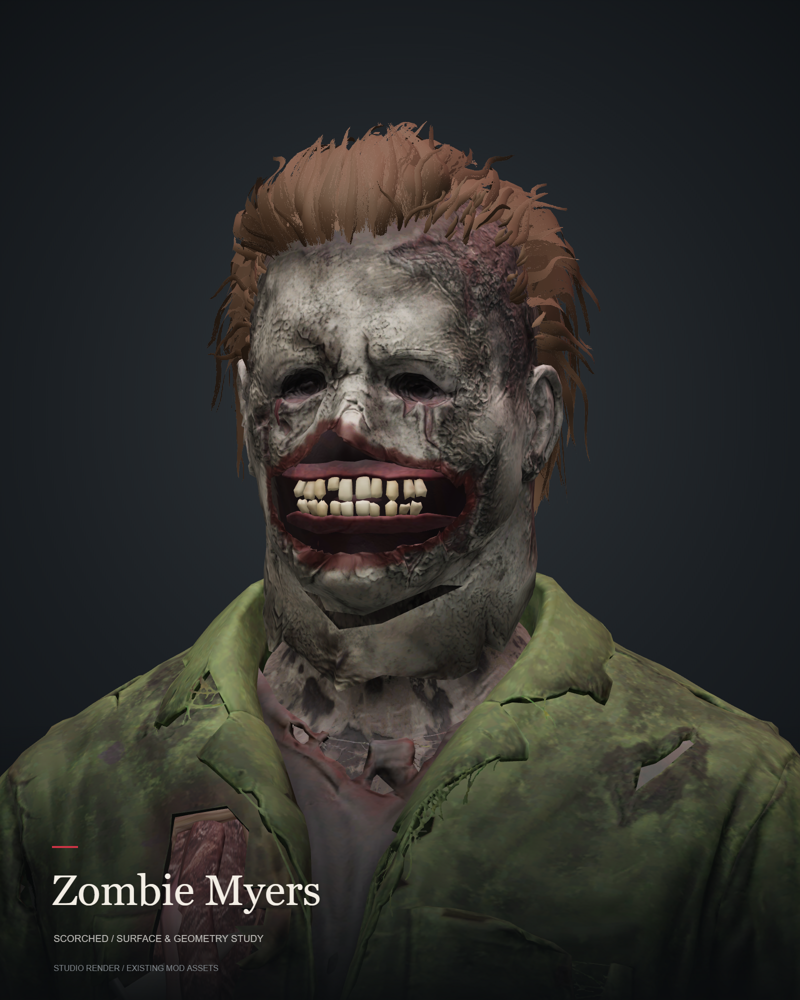
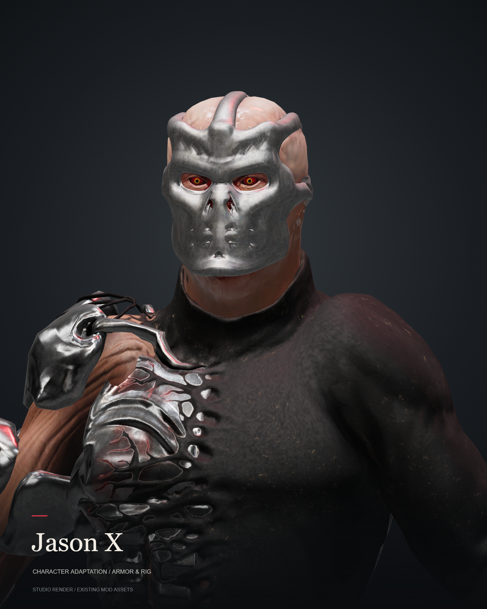
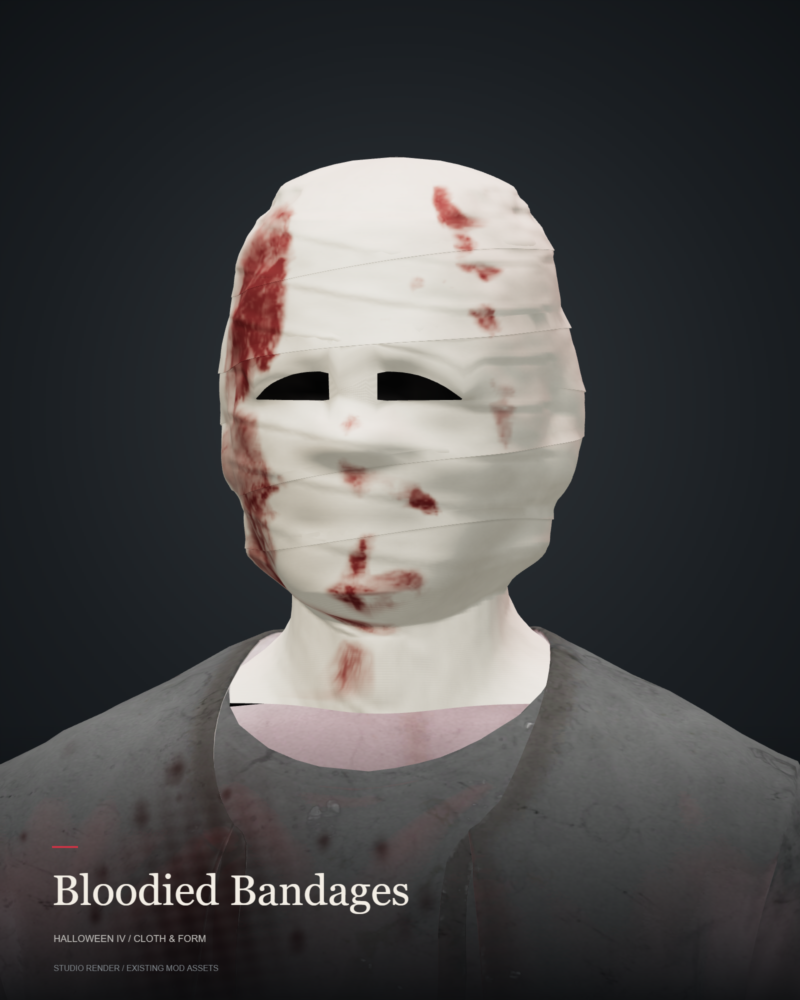

# Selected mod work

[Back to profile](https://github.com/chudlett) · [Nexus](https://next.nexusmods.com/profile/chudlet) · [TikTok — gameplay & mods](https://www.tiktok.com/@chudsun) · [Download the 12-second studio loop](https://github.com/chudlett/chudlett/raw/refs/heads/main/showcase-reel.mp4)

Character adaptations for Halloween, presented using the actual mod geometry and textures. These are studio renders; lighting, materials and motion differ from the game.

## Leatherface

A Leatherface replacement for the Scorched slot. The apron and tie are shown in their neutral pose here; the studio loop does not demonstrate cloth simulation.

## Zombie Myers

The v4 asset set, with the mask and clothing shown under studio lighting.

## Jason X

The corrected v2 geometry. This is an asset preview; the target Phantom slot's in-game routing was still unverified in the project notes used for this showcase.

## Bloodied Bandages

A bonus portrait using the v13 head, gown and texture assets.

## Credits & process

These projects adapt existing character assets. Original models, textures, rigs and characters remain the work of their respective creators and rights holders. Leatherface uses assets from The Texas Chain Saw Massacre; Halloween supplies target character assets and the rig. Jason X uses the supplied source assets.

Mod adaptations and this presentation were created with AI assistance. The studio renders use the existing geometry and textures, without AI image generation. They do not reproduce the game's cloth simulation, character animation, hair shaders or runtime LOD behavior.

This gallery contains rendered media, not source models or a playable mod download. Published downloads and installation instructions belong on Nexus.
